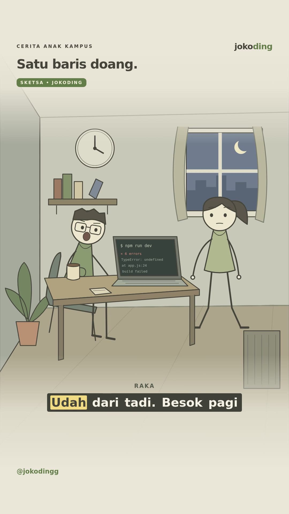
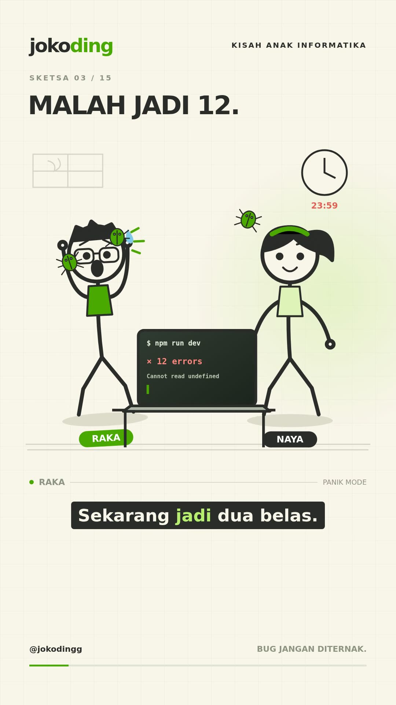

# Jokoding Ads Content

## Versi terbaru: Satu Baris Doang — percakapan natural

- **[Unduh video terbaru, 60 detik](https://github.com/irfanqs/jokoding-ads-content/raw/refs/heads/main/reels/jokoding-natural-60s.mp4)**
- [Naskah dan caption](reels/jokoding-natural-naskah.md)
- [Subtitle SRT](reels/jokoding-natural-60s.srt)



Mengikuti gaya animasi **video WhatsApp yang diunggah pengguna**: ilustrasi 2D bergaris tipis, warna redup, latar berperspektif yang memenuhi layar, vignette krem, perpindahan sudut kamera, serta subtitle pendek dengan sorotan kuning. Adegan kos, laptop, ponsel, dan cangkir dianimasikan di Remotion. Materi referensi hanya digunakan untuk mengamati gaya; footage dan audionya tidak disalin.

Raka dan Naya memakai bahasa percakapan sehari-hari. Humor muncul dari reaksi mereka, tanpa punchline di setiap balasan. Ada 18 giliran bicara, jeda percakapan, dan kartu CTA visual selama 2,5 detik terakhir. Kedua suara tetap merupakan **voice-over sintetis Indonesia**. Sorotan kata menggunakan timestamp TTS; bukaan mulut mengikuti energi audio, bukan lip-sync fonem.

### Render versi terbaru

```sh
npm ci
npm run typecheck
npm run studio
npm run render
```

Pilih komposisi `JokodingNatural` di Studio. Hasil render: `reels/jokoding-natural-60s.mp4`, 1080 × 1920, 30 fps, 60 detik. Chromium di lingkungan ini berada di `/usr/bin/chromium`. Rendering memakai audio yang sudah disertakan dan tidak memerlukan layanan TTS.

- Animasi: `src/natural.tsx`.
- Dialog: `src/natural-dialogue.json`.
- Timing kata, adegan, dan energi audio: `src/natural-timing.json`.
- Audio: `public/audio/natural/`.
- Regenerasi suara: `python scripts/natural_voiceover.py` dengan `edge-tts==7.3.1` dan FFmpeg. Cache audio berdasarkan teks dan suara; perubahan dialog menghasilkan klip baru. Timing dan SRT ikut diperbarui. Skrip menolak naskah yang perlu dipercepat berlebihan.
- Musik piano sintetis orisinal: `python scripts/natural_music.py` dengan NumPy dan FFmpeg.

Untuk video sebelumnya, gunakan `npm run render:previous` (komposisi `Jokoding`).

## Arsip versi kedua: Remotion, dua tokoh stickman, dan voice-over

- [Unduh video Remotion 60 detik](https://github.com/irfanqs/jokoding-ads-content/raw/refs/heads/main/reels/jokoding-remotion-60s.mp4)
- [Naskah dan caption terbaru](reels/jokoding-remotion-naskah.md)
- [Subtitle SRT](reels/jokoding-remotion-60s.srt)



Video vertikal **1080 × 1920, 30 fps, 60 detik**. Raka dan Naya berinteraksi melalui gestur, ekspresi, mulut saat berbicara, reaksi terhadap bug, serta adegan ponsel. Semua karakter dan properti digambar sebagai SVG dan dianimasikan per frame di React/Remotion. Tidak menggunakan gambar diam sebagai adegan.

Voice-over Indonesia sintetis: Ardi untuk Raka dan Gadis untuk Naya. Dialog dan timing ada di `src/dialogue.json` dan `src/timing.json`; audio siap render disertakan di `public/audio`. Gerakan mulut bersifat stilisasi saat dialog aktif, bukan lip-sync fonem. Highlight kata di subtitle memakai perkiraan progres durasi dialog.

### Menjalankan proyek

Prasyarat: Node.js 22+ dan Chromium. Lingkungan cloud ini memakai Node.js 24 dan `/usr/bin/chromium`.

```sh
npm ci
npm run typecheck
npm run studio
npm run render
```

`npm run render:previous` menghasilkan `reels/jokoding-remotion-60s.mp4`. Rendering tidak membutuhkan API key atau layanan TTS karena semua audio sudah disertakan. Jika lokasi Chromium berbeda, sesuaikan `--browser-executable` pada perintah di `package.json`.

Untuk membuat ulang voice-over setelah mengubah dialog, pasang `edge-tts==7.3.1` lalu jalankan `python scripts/voiceover.py`. Hapus hanya klip `public/audio/line-XX.mp3` yang memang ingin dibuat ulang; skrip mempertahankan klip yang sudah ada. FFmpeg dan ffprobe diperlukan untuk menyesuaikan durasi. Proses TTS membutuhkan koneksi ke layanan Microsoft; TLS tetap diverifikasi menggunakan CA sistem. Setelah mengubah durasi, sesuaikan juga SRT dan naskah.

### Referensi visual

[Referensi Instagram yang diberikan](https://www.instagram.com/reel/De-127zhMM0/) berhasil diakses ulang saat produksi versi ini. Referensi berisi video ilustrasi edukasi CTM dengan durasi sekitar 73,6 detik. Pendekatan visual yang diadaptasi: ilustrasi 2D sederhana, komposisi vertikal, perubahan adegan, gerak kamera, dan subtitle dengan sorotan kata. Cerita, karakter, dialog, dan animasi Jokoding dibuat baru; video/audio referensi tidak disertakan atau digunakan ulang. Warna krem, hijau, dan identitas Jokoding mengikuti materi pengguna.

Musik dan efek sintetis orisinal dari produksi sebelumnya dipakai sebagai latar pelan. Tidak ada klaim harga, jaminan nilai, atau waktu pengerjaan layanan.

## Arsip versi pertama: Yang Running Cuma Deadline

- [Unduh video MP4](https://github.com/irfanqs/jokoding-ads-content/raw/refs/heads/main/reels/jokoding-60s/jokoding-reels-60s.mp4)
- [Naskah dan caption](reels/jokoding-60s/naskah.md)

Video berdurasi 60 detik, vertikal 720 × 1280 (9:16), 24 fps, H.264 dengan audio AAC. Format komik animasi dengan dialog tertulis, musik dan efek bunyi sintetis, tanpa sulih suara.

Jika GitHub tidak menampilkan pemutar video, gunakan tautan unduh di atas atau buka file MP4 lalu pilih **Download raw file**. Putar file yang sudah diunduh melalui pemutar video perangkat.

Visual mengadaptasi materi Jokoding yang diberikan. Referensi Instagram tidak dapat diakses saat produksi; cerita dikembangkan dari brief.
